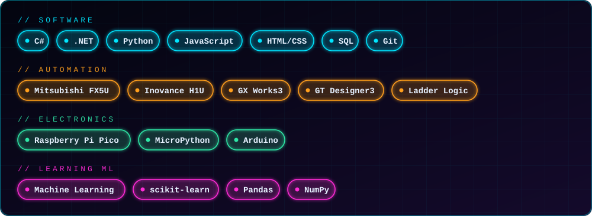

<!---
vickyrox/vickyrox is a ✨ special ✨ repository because its `README.md` (this file) appears on your GitHub profile.
--->

<div align="center">




<a href="mailto:vikasraikwar.786@gmail.com"></a>
<a href="https://github.com/vickyrox"></a>


</div>

---

## 👋 About Me

```csharp
public class Vikas
{
    public string GitHub      => "@vickyrox";
    public string Role        => "Hybrid Automation Engineer & .NET Developer";
    public string[] Domains   => new[] { "Industrial Automation", "Infrastructure Software", "Mechatronics" };
    public string Learning    => "Machine Learning 🌱";
    public string Interests   => "Technology & Electronics 👀";
    public string LookingFor  => "Collaboration on innovative mechatronics projects 💞️";
    public string Contact     => "vikasraikwar.786@gmail.com 📫";
}
```

- 👋 Hi, I'm **@vickyrox**
- 👀 I'm interested in **technology & electronics**
- 🌱 I'm currently learning **machine learning**
- 💞️ I'm looking to collaborate on my new innovative skills of **mechatronics**
- 📫 Reach me at **vikasraikwar.786@gmail.com**

I build things that **actually run on the shop floor** — PLC logic, HMI screens and the .NET software that talks to them.

---

## 🚀 Selected Work

> 🔗 My World

| Project | What it does | Stack | Links |
| --- | --- | --- | --- |
| 📡 **MLFF RFID Gateway** | TCP gateway that reads vehicle tag data from gantry readers for toll / MLFF systems | C# · .NET · TCP | [repo](#) |
| 🌐 **NetPulse** | Network monitoring system with a WinForms dashboard and database logging | .NET · WinForms | [repo](#) |
| ⚙️ **Crown Wheel Bolt-Tightening Machine** | PLC automation for a differential crown wheel tightening machine | Mitsubishi FX5U · GX Works3 | [repo](#) |
| 🔩 **G1G2 Press Controller** | Servo valve analog I/O and ram up/down control for a press machine | FX5U · Ladder Logic | [repo](#) |
| 🐄 **Pellet Mill Diagnostic Tool** | Offline fault-finding tool for a cattle-feed pellet plant (steam / urea / molasses) | HTML · JavaScript | [repo](#) |
| 🤖 **Robot Eyes** | Non-blocking blink engine + expressions on an SH1106 OLED | Raspberry Pi Pico · MicroPython | [repo](#) |
| 🏗️ **Site Management App** | Labour, stock, production and demand tracking in a single HTML file | HTML · JavaScript | [repo](#) |

---

## 🛠️ Tech Stack

<p align="center">
  
</p>

---

## 📊 GitHub Stats

<p align="center">
  
  
</p>

<p align="center">
  
</p>

### 🐍 Contribution Snake

<p align="center">
  <picture>
    <source media="(prefers-color-scheme: dark)" srcset="https://raw.githubusercontent.com/vickyrox/vickyrox/output/github-snake-dark.svg" />
    <source media="(prefers-color-scheme: light)" srcset="https://raw.githubusercontent.com/vickyrox/vickyrox/output/github-snake.svg" />
    
  </picture>
</p>

---

## 🤝 Let's Collaborate

Mechatronics, industrial automation, IoT, ya ML + automation ka koi idea ho — **let's build it together!** 🚀


